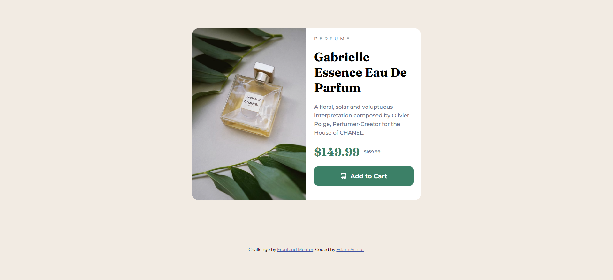

# Frontend Mentor - Product preview card component solution

This is a solution to the [Product preview card component challenge on Frontend Mentor](https://www.frontendmentor.io/challenges/product-preview-card-component-GO7UmttRfa). Frontend Mentor challenges help you improve your coding skills by building realistic projects.

## Table of contents

- [Overview](#overview)
  - [The challenge](#the-challenge)
  - [Screenshot](#screenshot)
  - [Links](#links)
- [My process](#my-process)
  - [Built with](#built-with)
  - [What I learned](#what-i-learned)
  - [Continued development](#continued-development)
  - [AI Collaboration](#ai-collaboration)
- [Author](#author)

## Overview

### The challenge

Users should be able to:

- View the optimal layout depending on their device's screen size
- See hover and focus states for interactive elements

### Screenshot



### Links

- Solution URL: [https://github.com/e5lama5hraf/product-preview-card-component](https://github.com/e5lama5hraf/product-preview-card-component)
- Live Site URL: [https://e5lama5hraf.github.io/product-preview-card-component/](https://e5lama5hraf.github.io/product-preview-card-component/)

## My process

### Built with

- Semantic HTML5 markup
- CSS custom properties
- Flexbox
- CSS Grid
- Mobile-first workflow
- [Google Fonts](https://fonts.google.com/) - Montserrat & Fraunces

### What I learned

**1. Switching images with `<picture>` instead of JavaScript.**
At first I used JavaScript to swap the mobile and desktop images on resize. Then I learned the `<picture>` element does the same job in pure HTML, with no script and no flicker:

```html
<picture>
  <source media="(min-width: 1024px)" srcset="images/image-product-desktop.jpg">
  
</picture>
```

**2. Making the image fill its column.**
`object-fit: cover` lets the image fill the card column on desktop without being stretched:

```css
.product-image {
  display: block;
  width: 100%;
  height: 100%;
  object-fit: cover;
}
```

**3. Accessible focus states.**
Removing the outline with `outline: none` hides the focus state from keyboard users. I used `:focus-visible` to add a clear outline instead:

```css
.add-to-cart-btn:focus-visible {
  outline: 3px solid var(--green-700);
  outline-offset: 3px;
}
```

**4. Buttons don't inherit fonts by default.**
I added `font-family: inherit` so the button uses Montserrat like the rest of the page.

**5. Using an SVG icon directly.**
I replaced a full icon library with the provided `icon-cart.svg`, and used a flex button so the icon stays aligned with the text at any width.

### Continued development

- Keep practicing responsive layouts with CSS Grid and Flexbox
- Test layouts on a wider range of screen sizes (320px and up)
- Keep improving accessibility: alt text, focus states, and color contrast

### AI Collaboration

I used Claude to review my code and give feedback on my HTML and CSS, and to help write this README. I built the solution myself, then used the feedback to remove the JavaScript, fix the focus state, and improve the button. What worked well was getting step-by-step suggestions that I could apply and test myself.

## Author

- GitHub - [@e5lama5hraf](https://github.com/e5lama5hraf)
